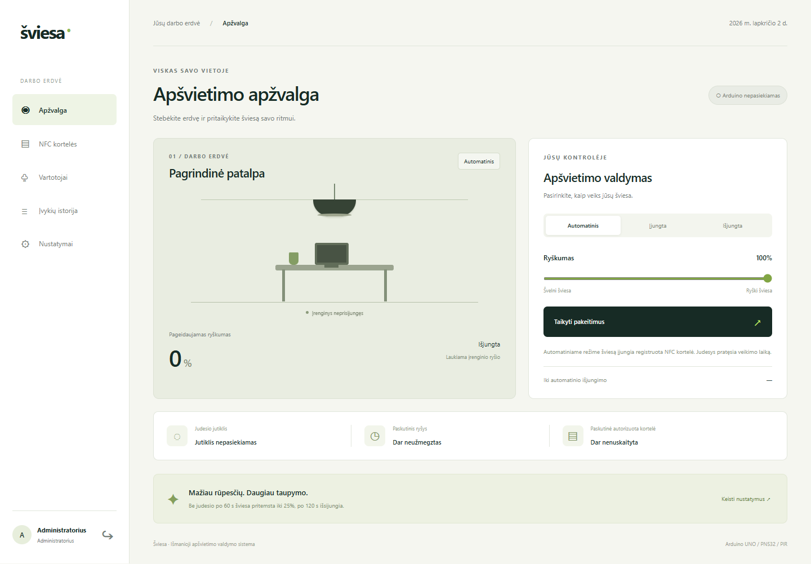

# Šviesa · Išmanioji apšvietimo valdymo sistema

Arduino UNO, PN532 NFC, PIR, relės ir MOSFET valdomas vienos patalpos apšvietimas. FastAPI serveris, SQLite duomenų bazė ir lietuviška WEB sąsaja kompiuteriui bei telefonui.



## Demonstracija be Arduino

Jau turint įdiegtas Python priklausomybes, VS Code PowerShell terminale paleiskite:

```powershell
.\start-demo.ps1
```

Scenarijus paleidžia serverį, jei šis dar neveikia, prideda demonstracinę NFC kortelę **D3A01234** ir paleidžia Arduino simuliatorių. Atidarykite http://127.0.0.1:8001. Simuliatoriaus terminale įrašykite `card`, `motion on`, `motion off`, `disconnect`, `connect`, `status` arba `quit` ir spauskite Enter. Sąsajoje aiškiai rodoma **„Simuliatorius“**. Išeinant iš demonstracijos sustabdomas tik jos pačios paleistas serveris; jau veikęs serveris paliekamas.

Jei serverį paleidote atskirai, simuliatoriui pakanka `.\start-simulator.ps1`. Pilna instrukcija, patikros scenarijai ir perėjimas prie tikros įrangos: **[TESTAVIMAS.md](docs/TESTAVIMAS.md)**. Prieš naudojant tikrą UNO simuliatorių būtina sustabdyti.

## Paleidimas Windows

Atidarykite projekto aplanką VS Code ir jo PowerShell terminale:

```powershell
# Jei .venv dar nėra: py -m venv .venv
.\.venv\Scripts\python.exe -m pip install -r backend\requirements.txt
.\start.ps1
```

Atidarykite **http://127.0.0.1:8001**. Pradinis vartotojas `admin`, sugeneruotas unikalus slaptažodis yra `backend/data/initial-credentials.txt`. Failas sukuriamas pirmo paleidimo metu. Slaptažodis nepateikiamas Git ar šaltinio kode. Kortelių pradžioje nėra: užregistruokite savo kortelę administratoriaus sąsajoje.

Jei PowerShell draudžia scenarijus, serverį galite paleisti tiesiogiai:

```powershell
.\.venv\Scripts\python.exe -m uvicorn backend.main:app --host 0.0.0.0 --port 8001
```

`Ctrl+C` sustabdo serverį. Kitas portas: `.\start.ps1 -Port 8003`. Paleiskite vieną serverio procesą, be kelių `--workers`. Įprastam naudojimui `--reload` nereikalingas.

Telefonui: abu įrenginiai turi būti tame pačiame vietiniame tinkle. Kompiuterio LAN IPv4 adresą raskite per `ipconfig`, tada telefone atidarykite `http://KOMPIUTERIO_IP:8001`. Jei Windows ugniasienė blokuoja ryšį, leiskite Python serveriui veikti privačiame tinkle. Serveris pats nekeičia ugniasienės taisyklių.

## Naudojimas

- **Apžvalga:** automatinis, rankinis įjungimo ir išjungimo režimai; ryškumas; PIR ir įrenginio ryšio būsena. Pasirinkimą patvirtinkite „Taikyti pakeitimus“.
- **Vartotojai:** administratorius sukuria vartotoją arba kitą administratorių. Slaptažodis turi turėti bent 12 simbolių. Paskyrą galima blokuoti ir vėl aktyvuoti.
- **NFC kortelės:** įrašykite PN532 Serial Monitor parodytą UID (be tarpų, 8 / 14 / 20 šešioliktainių simbolių), priskirkite vartotoją. Galima blokuoti arba pašalinti kortelę.
- **Įvykių istorija:** sėkmingos ir nesėkmingos autorizacijos, judesio pradžia, apšvietimo komandos, įrenginio pranešti išėjimo pokyčiai ir administravimo veiksmai. Yra filtravimas ir ankstesnių įrašų puslapiai.
- **Nustatymai:** pritemdymo laikas, išjungimo laikas, pritemdytas ryškumas. Pradinės vertės 60 s / 120 s / 25%.

NFC autorizacija pradeda automatinę sesiją. Judesys ją pratęsia. Pasibaigus laikui naują sesiją pradeda kortelė. Rankinis įjungimas serverio pusėje laiko šviesą įjungtą iki naujos komandos ar NFC autorizacijos. Detali sutartis ir palyginimas su skaidrėmis: [projekto kontekstas](docs/PROJEKTO_KONTEKSTAS.md).

## Arduino paruošimas

1. Arduino IDE pasirinkite **Arduino UNO** ir tinkamą COM prievadą.
2. Library Manager įdiekite `Ethernet` **2.0.2**, `Adafruit PN532` **1.3.4** (su `Adafruit BusIO` **1.17.4**) ir `ArduinoJson` **6.21.5**. ArduinoJson 7 šiam eskizui nenaudojamas.
3. Atidarykite `arduino/LightingController/LightingController.ino`.
4. Nukopijuokite `config.example.h` į **`config.h` tame pačiame aplanke**. `config.h` ignoruojamas Git.
5. Įrašykite kompiuterio IP, serverio portą (numatyta 8001), laisvą Arduino statinį IP, šliuzą ir potinklį. Arduino IP turi būti to paties LAN ir nesikirsti su DHCP ar kitu įrenginiu.
6. Į `DEVICE_KEY` įrašykite `backend/data/device-secret.txt` reikšmę. Raktas sugeneruojamas paleidžiant serverį. Jo niekur neviešinkite.
7. Sukonfigūruokite PN532 **I2C režimą** pagal savo modulio jungiklius. Patikrinkite, ar relė aktyvi LOW; pagal tai pakeiskite `RELAY_ACTIVE_LOW`.
8. Sujunkite, įkelkite eskizą. Serial Monitor: **115200 baud**. PN532 nuskaitytą UID užregistruokite WEB sąsajoje. Šis eskizas naudoja 4 arba 7 baitų kortelių UID (8 arba 14 simbolių); platesnis 10 baitų UID formatas priimamas API ir simuliatoriuje. PIR jutikliui po įjungimo reikia stabilizacijos pagal konkretaus modulio instrukciją.

### Signalų jungtys

| Komponentas | Arduino UNO |
| --- | --- |
| PN532 SDA / SCL | A4 / A5 (I2C) |
| PN532 IRQ / RESET | D2 / D7 |
| PIR OUT | D3 |
| Relės IN | D8 |
| MOSFET valdymas | D5 (PWM) |
| W5100 CS / MOSI / MISO / SCK | D10 / D11 / D12 / D13 (SPI) |
| Ethernet shield SD CS | D4, palaikomas HIGH |
| Valdymo grandinių GND | Bendra žemė pagal naudojamų modulių schemą |

**Pritemdymui būtinas LED apkrovai tinkamas loginio lygio MOSFET arba PWM valdiklio modulis. Relė pritemdymo neatlieka ir PWM į relę nejungiamas.** 12 V LED maitinimą relė perjungia, o MOSFET reguliuoja apkrovą pagal pasirinkto modulio schemą. Arduino išėjimas neturi tiesiogiai maitinti LED apkrovos. PN532 ir kitų modulių maitinimo bei signalų įtampos priklauso nuo konkrečios plokštelės: patikrinkite jos dokumentaciją. Projektas valdo 12 V LED grandinę, ne atvirą 230 V grandinę.

### Kai nutrūksta ryšys

Naujos NFC kortelės be serverio neautorizuojamos. Aktyvus automatinis režimas vietoje vykdo PIR ir laikmatį. Rankinis įjungimas vietoje baigiamas po nustatyto išjungimo intervalo be serverio atsako. Grįžus ryšiui Arduino priima serverio komandą. Nutrūkus ryšiui administratoriaus blokavimas fizinei plokštei iškart neperduodamas.

## API

WEB naudoja HttpOnly sesijos slapuką. Keičiančioms WEB užklausoms reikia `X-Requested-With: LightingApp`; sesijos galiojimas 8 val. Įrenginio API naudoja atskirą `X-Device-Key` antraštę. Galiojanti WEB sesija nepakeičia įrenginio rakto.

| Metodas / adresas | Paskirtis / prieiga |
| --- | --- |
| POST `/api/auth/login`, `/api/auth/logout` | Prisijungimas / atsijungimas |
| GET `/api/auth/me` | Dabartinė paskyra |
| GET / PUT `/api/lighting` | Būsena / režimas ir ryškumas, prisijungęs vartotojas |
| GET / PUT `/api/settings` | Laikmačiai, administratorius |
| GET / POST `/api/users` | Vartotojai, administratorius |
| PATCH `/api/users/{id}` | Paskyros aktyvumas, administratorius |
| GET / POST `/api/cards` | Kortelės, administratorius |
| PATCH / DELETE `/api/cards/{uid}` | Kortelės aktyvumas / pašalinimas, administratorius |
| GET `/api/events?kind=motion&limit=50&before_id=100` | Filtruojamas įvykių puslapis, administratorius |
| POST `/api/nfc/authorize` | `{"card_id":"A1B2C3D4"}`, įrenginio raktas |
| GET `/api/device/state` | Arduino komanda, įrenginio raktas |
| POST `/api/device/telemetry` | `{"motion":true,"actual_brightness":100}`, įrenginio raktas |

Schema: `/openapi.json`. Arduino gauna mažą JSON atsakymą su režimu, ryškumu ir laikmačiais. Telemetrija siunčiama kas 2 s. WEB būsena tikrinama kas 3 s. `actual_brightness` yra paskutinė Arduino programos pranešta PWM būsena, o ne nepriklausomo fizinio jutiklio matavimas.

## Duomenys ir saugumas

SQLite failas `backend/data/lighting.sqlite3` saugo paskyras, maišos reikšmes, korteles, sesijas, nustatymus ir įvykius. Slaptažodžiams naudojamas scrypt su atskira druska, sesijų tokenų bazėje saugomos SHA-256 maišos reikšmės. Nesėkmingi prisijungimai registruojami įvykių istorijoje. Laukimo laikotarpis po neteisingų slaptažodžių netaikomas: kitą bandymą galima atlikti iš karto.

`backend/data`, `.venv`, privačios Arduino konfigūracijos ir laikini failai ignoruojami Git. Atsarginei kopijai sustabdykite serverį ir nukopijuokite **visą** `backend/data` aplanką. Trinant šį aplanką būtų prarasti duomenys ir sugeneruotas kitas įrenginio raktas, todėl įprastam darbui jo netrinkite.

Pasirenkami aplinkos kintamieji (PowerShell `$env:VARDAS='reikšmė'` prieš paleidimą):

| Kintamasis | Paskirtis |
| --- | --- |
| `LIGHTING_ADMIN_PASSWORD` | Pradinis admin slaptažodis tik naujai bazei, bent 12 simbolių |
| `LIGHTING_DEVICE_KEY` | Įrenginio raktas vietoje sugeneruoto failo, bent 32 simboliai |
| `LIGHTING_DATA_DIR` | Atskiras duomenų katalogas, pvz. bandymams |
| `LIGHTING_COOKIE_SECURE` | `1` HTTPS aplinkai; vietiniam HTTP palikite `0` |

NFC UID naudojamas mokomajam prototipui ir gali būti klonuojamas. W5100 HTTP ryšyje raktas nešifruojamas: šį segmentą laikykite patikimame izoliuotame LAN. Viešą WEB prieigą pateikite per HTTPS reverse proxy, nustatykite `LIGHTING_COOKIE_SECURE=1` ir neatverkite Arduino API nepatikimam tinklui. Šiame vietiniame paleidime HTTPS sertifikatas nekonfigūruotas.

## Tikrinimas

```powershell
.\.venv\Scripts\python.exe -m pip install -r backend\requirements-dev.txt
.\.venv\Scripts\python.exe -m pytest -q
node --check frontend\app.js
```

Naršyklės scenarijams (Node.js ir įdiegtas Google Chrome):

```powershell
npm ci
npm run test:browser
```

Naršyklės testas paleidžia atskirą serverį laisvame porte su laikina baze. Tikrina prisijungimą, valdymą, vartotojus, korteles, HTML įvesties saugų atvaizdavimą, teises ir mobilųjį vaizdą. Jei Chrome yra kitoje vietoje, nurodykite jo kelią per `BROWSER_PATH`. Node.js reikalingas tik šiems testams, serveriui ir sąsajai jo nereikia. Pilnas patikrintos Python aplinkos versijų sąrašas yra `backend/requirements-lock.txt`.

Testai naudoja laikinas bazes ir nekeičia jūsų kortelių. Tikrinamos rolės, CSRF apsauga, sesijos, įrenginio raktas, pakartotiniai prisijungimo bandymai be blokavimo, NFC, judesys, pritemdymas, išjungimas, blokavimas, duomenų išlikimas ir įvykių puslapiai. UNO eskizas patikrintas kompiliuojant `arduino:avr:uno`, Arduino AVR Boards 1.8.8. Fizinį komponentų veikimą reikia patikrinti su prijungta įranga.

## Struktūra

```text
backend/main.py                    API, duomenų bazė, autorizacija ir būsenų logika
backend/requirements.txt           serverio priklausomybės
backend/requirements-dev.txt       testų priklausomybės
frontend/                         HTML, CSS, JavaScript sąsaja
arduino/LightingController/       UNO programa ir konfigūracijos pavyzdys
tests/test_system.py              integraciniai API testai
tests/test_simulator.py           vietinio valdiklio ir tikro HTTP ryšio testai
tools/device_simulator.py         interaktyvus valdiklis be fizinės įrangos
tools/configure-arduino.ps1       privatus IP ir rakto konfigūracijos generatorius
docs/PROJEKTO_KONTEKSTAS.md        vizija, pasirinkimai ir veikimo sutartis
start.ps1                        serverio paleidimas
start-demo.ps1                   serveris ir simuliatorius vienu scenarijumi
```

Bibliotekų dokumentacija: [FastAPI testavimas](https://fastapi.tiangolo.com/advanced/testing-events/), [Adafruit PN532](https://github.com/adafruit/Adafruit-PN532), [ArduinoJson HTTP kliento pavyzdys](https://arduinojson.org/v6/example/http-client/).
